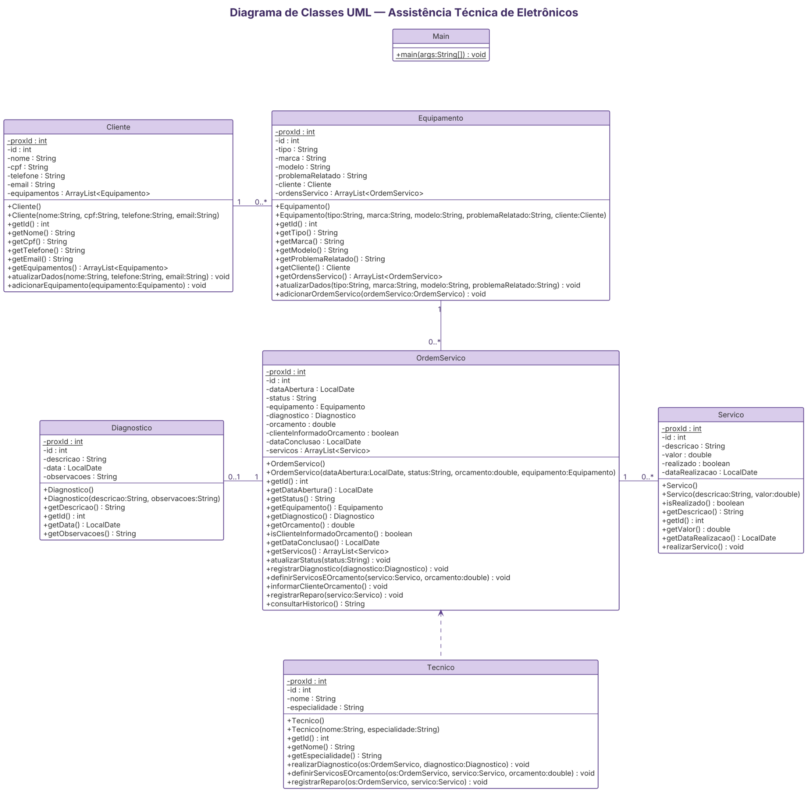
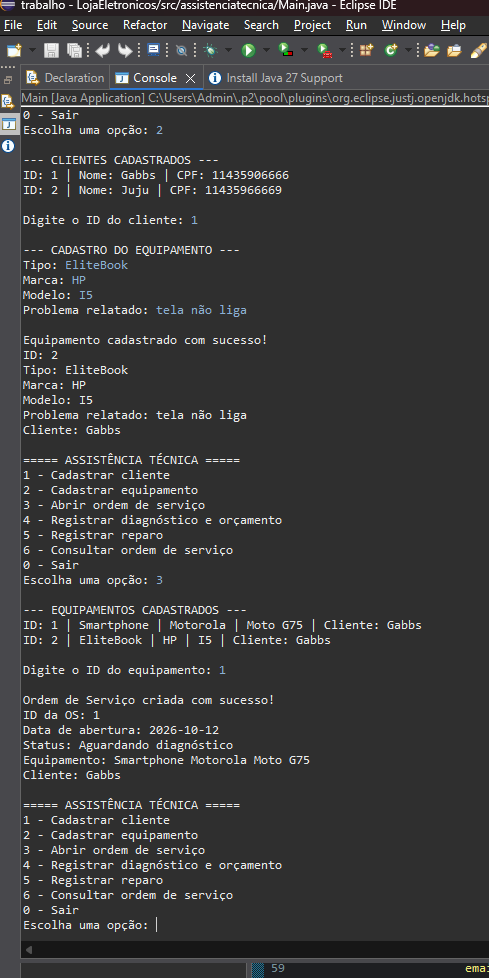
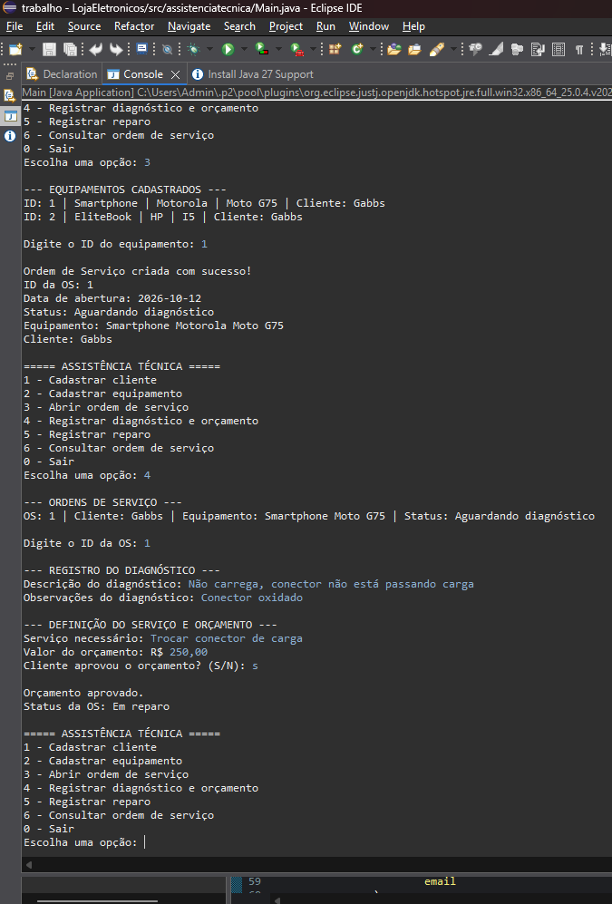

<p align="center">
  
</p>

# 🔧 Assistência Técnica de Eletrônicos

Sistema desenvolvido em **Java** durante meus estudos em Desenvolvimento de Sistemas, aplicando conceitos de **Programação Orientada a Objetos (POO)** na construção de um fluxo funcional de assistência técnica.

O projeto começou com a modelagem das classes e evoluiu para uma aplicação executável via console, permitindo cadastrar clientes e equipamentos, abrir ordens de serviço e acompanhar o processo de diagnóstico, orçamento e reparo.

---

## 📌 Sobre o projeto

O sistema representa o fluxo de atendimento de uma assistência técnica de eletrônicos.

A aplicação permite acompanhar um equipamento desde seu cadastro até o encerramento da ordem de serviço, mantendo os relacionamentos entre cliente, equipamento, diagnóstico, serviços e ordem de serviço.

O desenvolvimento foi realizado em duas etapas:

### Parte 1 — Modelagem orientada a objetos

- definição das classes;
- atributos e métodos;
- construtores;
- encapsulamento;
- relacionamentos entre objetos;
- utilização de coleções.

### Parte 2 — Implementação funcional

- interação com o usuário via console;
- cadastro e consulta de objetos;
- abertura de ordens de serviço;
- registro de diagnóstico e orçamento;
- controle do fluxo de reparo;
- atualização de status;
- consulta ao histórico da ordem de serviço;
- validações durante a execução.

---

## ⚙️ Funcionalidades

O menu principal permite:

1. Cadastrar cliente
2. Cadastrar equipamento
3. Abrir ordem de serviço
4. Registrar diagnóstico e orçamento
5. Registrar reparo
6. Consultar ordem de serviço
0. Sair

Durante a execução, o sistema mantém os objetos em coleções e permite selecionar clientes, equipamentos e ordens de serviço por meio de identificadores gerados automaticamente.

---

## 🧩 Estrutura do sistema

### `Cliente`

Armazena os dados do cliente e mantém sua coleção de equipamentos.

### `Equipamento`

Representa o equipamento recebido pela assistência, mantendo sua associação com um cliente e seu histórico de ordens de serviço.

### `Diagnostico`

Registra a descrição, as observações e a data do diagnóstico técnico.

### `Servico`

Representa os serviços definidos para a ordem de serviço e controla sua realização.

### `OrdemServico`

Centraliza o fluxo do atendimento, relacionando equipamento, diagnóstico, orçamento, serviços, status e conclusão.

### `Tecnico`

Representa o profissional responsável pelas operações técnicas de diagnóstico, orçamento e reparo.

### `Main`

Responsável pela interação com o usuário através do menu no console e pela execução das funcionalidades do sistema.

---

## 🔗 Relacionamentos

A modelagem do sistema estabelece os seguintes relacionamentos principais:

- um **Cliente** pode possuir vários **Equipamentos**;
- cada **Equipamento** pertence a um cliente;
- um **Equipamento** pode possuir várias **Ordens de Serviço**;
- cada **Ordem de Serviço** pertence a um equipamento;
- uma **Ordem de Serviço** pode possuir um diagnóstico;
- uma **Ordem de Serviço** pode possuir vários serviços;
- o **Técnico** executa operações relacionadas às ordens de serviço.

---

## 🧠 Conceitos de POO praticados

Durante o desenvolvimento foram aplicados:

- classes e objetos;
- atributos e métodos;
- construtores;
- encapsulamento;
- métodos de acesso;
- associação entre objetos;
- relacionamento entre classes;
- coleções com `ArrayList`;
- separação de responsabilidades;
- manipulação de objetos relacionados.

> Conceitos como herança, classes abstratas e interfaces não foram adicionados artificialmente, pois não eram necessários para a solução proposta.

---

## 🗺️ Diagrama de Classes UML

O diagrama abaixo representa a estrutura final do sistema, incluindo as classes, seus principais atributos e métodos, multiplicidades e relacionamentos.

<p align="center">
  
</p>

O modelo representa as classes `Cliente`, `Equipamento`, `Diagnostico`, `Servico`, `OrdemServico`, `Tecnico` e `Main`, mantendo a estrutura utilizada na implementação final do projeto.

---

## 💻 Demonstração

A aplicação é executada via console e apresenta um menu interativo para realizar as operações do sistema.

### Cadastro de equipamento e abertura de ordem de serviço

Neste fluxo, o sistema permite selecionar um cliente, cadastrar seu equipamento e abrir uma nova ordem de serviço associada a ele.

<p align="center">
  
</p>

### Diagnóstico e orçamento

Após a abertura da ordem de serviço, o técnico pode registrar o diagnóstico, informar observações, definir o serviço necessário e seu orçamento.

Após o cliente ser informado sobre o orçamento, o fluxo da ordem de serviço pode avançar para a etapa de reparo.

<p align="center">
  
</p>

---

## 🛠️ Tecnologias utilizadas

- Java
- Eclipse IDE
- Git
- GitHub
- UML / PlantUML

---

## 📂 Estrutura de pastas

```text
LojaEletronicos/
├── assets/
│   ├── banner-gabbs-data-crafter.png
│   ├── uml-assistencia-tecnica.png
│   ├── demo-abertura-os.png
│   └── demo-diagnostico-orcamento.png
├── src/
│   └── assistenciatecnica/
│       ├── Cliente.java
│       ├── Diagnostico.java
│       ├── Equipamento.java
│       ├── Main.java
│       ├── OrdemServico.java
│       ├── Servico.java
│       └── Tecnico.java
├── .classpath
├── .project
├── .gitignore
└── README.md
```

---

## ▶️ Fluxo da aplicação

```text
Cliente
   ↓
Equipamento
   ↓
Ordem de Serviço
   ↓
Diagnóstico
   ↓
Orçamento
   ↓
Aprovação
   ↓
Reparo
   ↓
Encerramento
```

O status da ordem de serviço acompanha sua evolução durante o atendimento, permitindo consultar posteriormente as informações registradas.

---

## 🌱 Evolução do projeto

Este projeto representa uma das minhas primeiras aplicações em Java utilizando Programação Orientada a Objetos.

A primeira versão teve como foco a estrutura e a modelagem das classes. Na segunda etapa, o projeto evoluiu para uma aplicação funcional com interação pelo console, manipulação de coleções, relacionamentos entre objetos e implementação do fluxo completo de uma ordem de serviço.

Mais do que concluir uma atividade acadêmica, este repositório registra minha evolução prática no desenvolvimento com Java.

---

## 👩‍💻 Autora

**Gabriela Oliveira Ferreira**

Estudante de **Desenvolvimento de Sistemas** e **Ciência de Dados**.

Projeto desenvolvido durante meus estudos de **Programação Orientada a Objetos**.